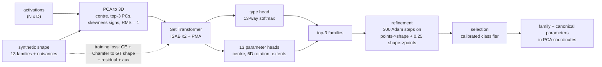

# Fitting geometric shapes to neural geometry

**Status:** the method and pipeline are implemented. Results tables and figures are added below as experiments finish, and every number is generated from `results/`.

Interpretability research keeps finding **low-dimensional shapes** in the activations of neural networks:
- circles for weekdays and months ([Engels et al. 2024](https://arxiv.org/abs/2405.14860));
- a helix in GPT-2's positional embeddings ([Yedidia 2023](https://www.lesswrong.com/posts/qvWP3aBDBaqXvPNhS/gpt-2-s-positional-embedding-matrix-is-a-helix));
- a helix-like manifold for character counts ([Gurnee et al. 2025](https://transformer-circuits.pub/2025/linebreaks/index.html));
- a paraboloid for colors, a helix for years, and lines for temperature and age ([Bhalla et al. 2026](https://arxiv.org/abs/2604.28119));
- clock circles in grokked modular addition ([Nanda et al. 2023](https://arxiv.org/abs/2301.05217));
- polytopes in toy models of superposition ([Elhage et al. 2022](https://transformer-circuits.pub/2022/toy_model/index.html)).

These shapes are usually spotted and fitted **by hand**. This repository does three things:

1. **Shape catalog.** [docs/shape_catalog.md](docs/shape_catalog.md) lists the shapes found empirically so far. Each entry gives the model, layer, method, whether the shape is visible in the top-3 PCs, and a source link.
2. **A learned shape fitter.** It is trained **only on synthetic shapes**. The input is a 3D point cloud: the **top-3 PCA coordinates of activations**. The output is:
   - a **shape family**, one of 13;
   - **parameters that specify the shape uniquely**, after canonicalizing the shape's symmetries;
   - a fit that **passes as close to the input points as possible**, because of a residual loss and test-time refinement.
3. **Evaluation.** The fitter is tested on held-out synthetic data and on **real activations** from GPT-2, Llama-3.1-8B, a grokked modular-addition transformer and toy models of superposition. It is compared with classical baselines, random controls and ablations.

The hypotheses, metrics and falsification criteria were preregistered before any training: [reports/preregistration.md](reports/preregistration.md).


## Results

Every number and figure in this section is generated by `uv run python run.py report --config main.yaml` from `results/`. Text between the `BEGIN`/`END` markers is overwritten by that command.

### Synthetic test set: method vs. baselines, controls and ablations

<!-- BEGIN:results_table -->
<!-- END:results_table -->


### Real activations

<!-- BEGIN:real_table -->
<!-- END:real_table -->


### Preregistered hypotheses

<!-- BEGIN:hypotheses_table -->
<!-- END:hypotheses_table -->

More detail: [reports/summary.md](reports/summary.md), [exp01 (synthetic)](reports/exp01_synthetic.md), [exp02 (real activations)](reports/exp02_real_activations.md), [deviations from the preregistration](reports/deviations.md).

## Architecture



## The 13 shape families

| Family | Unique parameters | Empirical anchor (see catalog) |
|---|---|---|
| `blob` | Gaussian: center, axes, σ1≥σ2≥σ3 | Null class for controls |
| `clusters` | k = 2..6 centroids sorted by PC1, spread | True vs. false statements ([Marks & Tegmark](https://arxiv.org/abs/2310.06824)) |
| `polytope` | Regular subtype, center, circumradius, sorted vertices | Superposition polytopes ([Elhage et al.](https://transformer-circuits.pub/2022/toy_model/index.html)) |
| `line` | Endpoints | Temperature, age ([Bhalla et al.](https://arxiv.org/abs/2604.28119)) |
| `arc` | Center, normal, radius, extent (closed circle when the extent is 2π) | Days, months, clock |
| `ellipse` | Center, normal, major axis, a ≥ b | A linearly distorted circle; no separate empirical anchor |
| `helix` | Axis, radius, signed pitch, turns, phase | GPT-2 W_pos, counting, years |
| `ringing` | c + Σₖ aₖ cos(kπs) eₖ | The PCA horseshoe artifact, a confounder ([Novembre & Stephens 2008](https://doi.org/10.1038/ng.139)) |
| `disc` | Filled ellipse | "Pizza" in modular addition ([Zhong et al.](https://arxiv.org/abs/2306.17844)) |
| `sphere` | Center, radius, pole, cap angle | Cities ([Tiblias et al.](https://arxiv.org/abs/2510.01025)) |
| `paraboloid` | Frame, κ1 ≥ \|κ2\|, patch radius (bowl, saddle or trough) | Colors ([Bhalla et al.](https://arxiv.org/abs/2604.28119)) |
| `cone` | Frustum: axis, bottom and top radius, height (covers cylinders) | Anisotropy ([Ethayarajh 2019](https://arxiv.org/abs/1909.00512)) |
| `torus` | Center, axis, R, r | Grid cells ([Gardner et al. 2022](https://doi.org/10.1038/s41586-021-04268-7)), modular addition |

## Method (short version)
1. **Preprocessing.** Synthetic and real clouds go through exactly the same steps:
   - center the points;
   - project onto the top-3 principal components;
   - set the sign of each axis by its skewness;
   - for 3D input, force a right-handed frame;
   - scale to RMS radius 1, **without whitening**.

   Code: [`geometry/preprocess.py`](src/neurogeom/geometry/preprocess.py).
2. **Synthetic data, generated on the fly.** For each shape family we sample ground-truth parameters, with label margins so that nested families are not ambiguous. Then we sample 5–1024 points with these perturbations:
   - noise, sometimes anisotropic;
   - non-uniform density;
   - outliers;
   - for 25% of samples, embedding into R^D (D ∈ {16, 64, 256}) with noise in every dimension, followed by PCA back to 3D, which mimics activations.

   Train, validation and test sets come from disjoint seed streams. Code: [`data/synth.py`](src/neurogeom/data/synth.py).
3. **Model.** A Set Transformer encoder (ISAB×2 + PMA; [Lee et al. 2019](https://arxiv.org/abs/1810.00825), adapted from the MIT-licensed [reference code](https://github.com/juho-lee/set_transformer)) feeds:
   - a 13-way type head;
   - one parameter head per family, using 6D rotations ([Zhou et al. 2019](https://arxiv.org/abs/1812.07035)).
4. **Loss.** Cross-entropy on the family, plus **Chamfer distance between the predicted shape and the noise-free ground-truth shape**, plus a residual from the input points to the predicted shape, plus annealed auxiliary axis and scale terms. Chamfer compares point sets, so it is invariant to every parameter symmetry.
5. **Inference.** Take the top-3 families. Refine each with test-time optimization of a two-sided point–shape distance. Pick the family with a calibrated classifier, or with geometric AIC ([Kanatani](https://iim.cs.tut.ac.jp/member/kanatani/papers/acmodel.pdf)) as an ablation. Finally, map the result back to PCA coordinates and canonicalize.

## What happens when you run it

```text
run.py <phase>
  check-env     torch / CUDA / GPU sanity check
  catalog       catalog.yaml -> docs/shape_catalog.md
  train         on-the-fly synthetic batches -> checkpoints/<run>/final.pt, results/<run>/train/curve.json
  eval-synth    fixed test set (seed stream "test") -> method vs. baselines vs. ablations -> results/<run>/synth/
  extract-real  real activations (GPT-2 W_pos, grokked model, toy models, Llama-3.1-8B prompts) -> data_cache/real/*.npz
  eval-real     top-3 PCA -> fitter (+ subsampling stability, held-out residual, controls) -> results/<run>/real/
  report        regenerates every table, figure and number in README / reports / paper from results/
```

Each phase writes a timestamped log to `logs/`.

## Installation and usage

**Requirements:** Windows or Linux, an NVIDIA GPU (developed on an RTX 5070 Laptop with 8 GB), and [uv](https://docs.astral.sh/uv/). PyTorch comes from the CUDA 13.0 wheel index, as configured in `pyproject.toml`.

Set up the environment:

```bash
uv sync
```

```bash
cp .env.example .env
```

In `.env`, set `HF_HOME` to wherever you want to cache model weights.

Run the tests:

```bash
uv run pytest
```

Run a short end-to-end smoke test:

```bash
uv run python run.py check-env train --config smoke.yaml
```

Train the full model (about 100 minutes on an 8 GB laptop GPU):

```bash
uv run python run.py train --config main.yaml
```

Llama-3.1-8B is gated. Accept its license on Hugging Face, or use the ungated mirror `unsloth/Meta-Llama-3.1-8B`. The mirror's safetensors sha256 hashes match the official ones; we verified this on 2026-10-31.

## Repository layout
- `src/neurogeom/`: the package, with one subpackage per phase: `geometry`, `shapes`, `data`, `model`, `train`, `infer`, `baselines`, `realdata`, `eval` and `report`.
- `configs/`: YAML configs. `base.yaml` holds the defaults; `smoke.yaml`, `main.yaml` and the ablation configs override them.
- `tests/`: pytest suite covering geometry, every shape family, the generator, the model and the loss.
- `reports/`: the preregistration, per-experiment reports and the summary.
- `docs/`: the catalog and the methodology.
- `paper/`: the paper source.

## Technologies
PyTorch 2.14 (CUDA 13), Hugging Face transformers, NumPy and SciPy, scikit-learn, ripser.py, matplotlib, plotly, uv and pytest.
