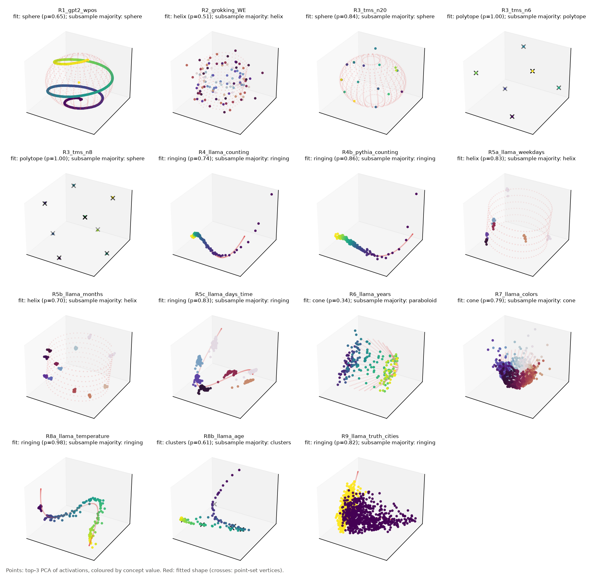
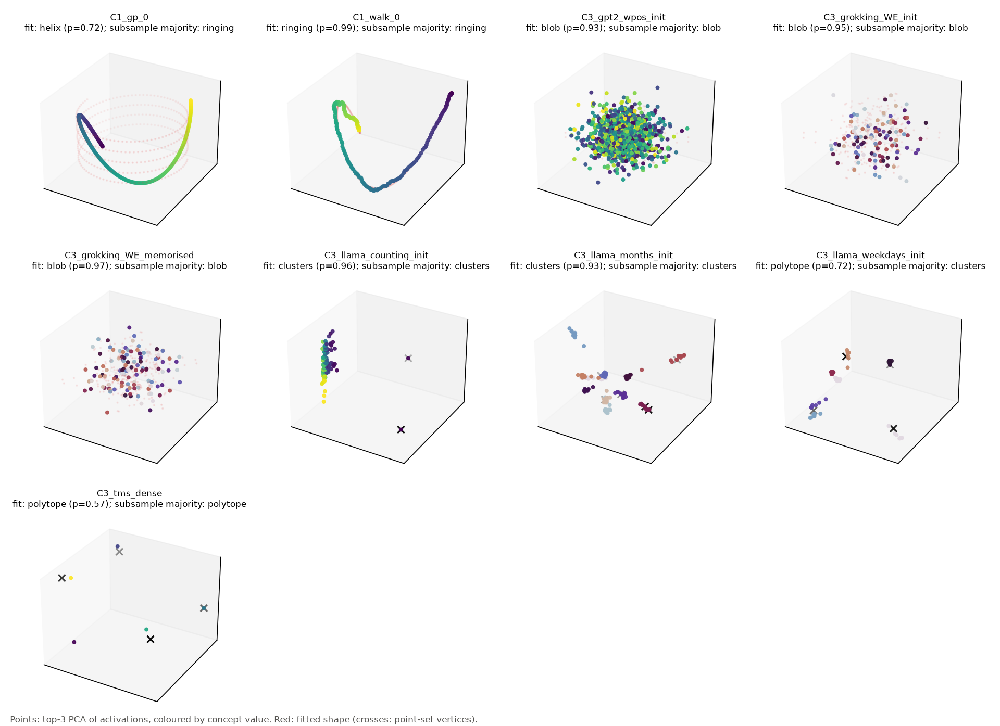
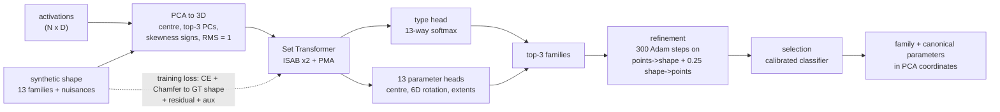

# Fitting geometric shapes to neural geometry

**Status:** first trained model (`main_s0`) evaluated with its controls and baselines. Postponed to later stages: trained ablations, more models, and seed and hyperparameter sweeps ([deviations](reports/deviations.md)).
**Links:** [paper (PDF)](paper/main.pdf) · [interactive explorer](https://burnycoder.github.io/geometrical-shape-fitting-in-llm-mechanistic-interpretability/) · [model on Hugging Face](https://huggingface.co/BurnyCoder/neurogeom-shape-fitter-main-s0) · [summary of all experiments](reports/summary.md)

Interpretability research keeps finding **low-dimensional shapes** in the activations of neural networks:
- circles for weekdays and months ([Engels et al. 2024](https://arxiv.org/abs/2405.14860));
- a helix in GPT-2's positional embeddings ([Yedidia 2023](https://www.lesswrong.com/posts/qvWP3aBDBaqXvPNhS/gpt-2-s-positional-embedding-matrix-is-a-helix));
- a helix-like manifold for character counts ([Gurnee et al. 2025](https://transformer-circuits.pub/2025/linebreaks/index.html));
- a paraboloid for colors, a helix for years, and lines for temperature and age ([Bhalla et al. 2026](https://arxiv.org/abs/2604.28119));
- clock circles in grokked modular addition ([Nanda et al. 2023](https://arxiv.org/abs/2301.05217));
- polytopes in toy models of superposition ([Elhage et al. 2022](https://transformer-circuits.pub/2022/toy_model/index.html)).

These shapes are usually spotted and fitted **by hand**. This repository does three things:

1. **Shape catalog.** [docs/shape_catalog.md](docs/shape_catalog.md) lists the shapes found empirically so far. Each entry gives the model, layer, method, whether the shape is visible in the top-3 PCs, and a source link.
2. **A learned shape fitter.** It is trained **only on synthetic shapes**. The input is a 3D point cloud: the **top-3 PCA coordinates of activations**. The output is:
   - a **shape family**, one of 13;
   - **parameters that specify the shape uniquely**, after canonicalizing the shape's symmetries;
   - a fit that **passes as close to the input points as possible**, because of a residual loss and test-time refinement.
3. **Evaluation.** The fitter is tested on held-out synthetic data and on **real activations** from GPT-2, Llama-3.1-8B, a grokked modular-addition transformer and toy models of superposition. It is compared with classical baselines, random controls and ablations.

The hypotheses, metrics and falsification criteria were preregistered before any training: [reports/preregistration.md](reports/preregistration.md).

### Highlights (generated)

<!-- BEGIN:headline -->
- **Synthetic test set (39,000 clouds, 13 families):** the method picks the correct family in 87.9% [87.6, 88.2] of clouds; median Chamfer distance to the ground-truth shape 0.156 (RMS-radius units).
- **Same 3,120 clouds for every system:** method 87.4% [86.2, 88.5], B2 features + boosting 64.5% [62.8, 66.2], B1 classical fit + geometric AIC 52.2% [50.6, 54.0], trivial baselines 7.7-7.9%.
- **H1** (macro-F1 method - B1): 0.3741 [0.3579, 0.3903], Holm p < 1e-16: supported.
- **H2** (median Chamfer method - B1): -0.0554 [-0.0645, -0.0462], Holm p < 1e-16: supported.
- **H5b_refinement** (median Chamfer method - no refinement): -0.0033 [-0.0046, -0.0021], Holm p < 1e-16: supported.
- **Selection rule:** choosing the family by geometric AIC instead of the classifier drops accuracy to 64.6% [64.1, 65.1].
- **Calibration:** temperature T = 0.772 lowers ECE from 0.044 to 0.022 and NLL from 0.397 to 0.373.
- **H3, real activations:** the coarse shape class (point set / curve / surface / blob) agrees with the literature on 7/12 preregistered datasets (exact 95% CI 28-85%), label-permutation p = 0.125: not supported.
- **H4, controls:** matched-covariance Gaussians are labelled blob 86% of the time; ordinal-process controls ringing 60% vs helix 40%: supported. Post hoc: smooth Gaussian processes alone are labelled helix in 80%, random walks in 0%.
<!-- END:headline -->

**In plain words.**
- **Where the method is better.** On computer-generated shapes it names the right shape far more often than the classical approach of fitting every shape and picking one by geometric AIC, or a classifier on hand-made features. Its fitted shapes are also closer to the true ones.
  - The gap is largest when there are few points.
  - The classical approach loses mostly at *choosing* the family, not at fitting it.
  - Test-time refinement makes the shape hug the points more tightly, but never changes which family is chosen.
- **Where it is worse or fails.** On real activations it agrees with the shapes reported in the literature only about as often as chance would allow. The failures have clear causes:
  - shapes outside its 13 families, such as GPT-2's spiral of positions, which it calls a sphere;
  - more than 6 separate groups (weekdays, months);
  - clouds whose top 3 principal components hold only a fraction of the variance (years, the grokked model).
- **Controls.** Random Gaussian clouds are correctly called blobs, and random walks are correctly called PCA "ringing" artifacts. But smooth random processes are often mistaken for helices. A helix label therefore needs the extra held-out check from the preregistration before it means anything.




## Results

Every number and figure in this section is generated by `uv run python run.py report --config main.yaml` from `results/`. Text between the `BEGIN`/`END` markers is overwritten by that command.

### Synthetic test set: method vs. baselines, controls and ablations

<!-- BEGIN:results_table -->
| System | n | Fine accuracy [95% CI] | Macro-F1 [95% CI] | Coarse accuracy | Superset-OK accuracy | Median Chamfer to GT [95% CI] | Mean residual | Median axis error (deg) |
|---|---|---|---|---|---|---|---|---|
| Method (network + refinement) | 39000 | 87.9% [87.6, 88.2] | 0.879 [0.876, 0.882] | 92.7% | 88.4% | 0.156 [0.154, 0.158] | 0.105 | 1.1 |
| Method, baseline subset | 3120 | 87.4% [86.2, 88.5] | 0.873 [0.862, 0.884] | 92.3% | 87.9% | 0.154 [0.147, 0.161] | 0.106 | 1.0 |
| A3: no refinement | 39000 | 87.9% [87.6, 88.2] | 0.879 [0.876, 0.882] | 92.7% | 88.4% | 0.159 [0.157, 0.162] | 0.120 | 1.5 |
| A5: G-AIC selection | 39000 | 64.6% [64.1, 65.1] | 0.627 [0.623, 0.632] | 77.5% | 68.8% | 0.182 [0.179, 0.185] | 0.108 | 0.8 |
| A5: hybrid selection | 39000 | 85.6% [85.2, 85.9] | 0.858 [0.854, 0.861] | 91.1% | 86.6% | 0.157 [0.155, 0.159] | 0.103 | 1.1 |
| B1: classical fit + G-AIC | 3120 | 52.2% [50.6, 54.0] | 0.499 [0.484, 0.515] | 70.7% | 58.1% | 0.209 [0.200, 0.221] | 0.117 | 0.7 |
| B2: features + boosting | 3120 | 64.5% [62.8, 66.2] | 0.645 [0.629, 0.662] | 85.1% | 68.0% | 0.237 [0.221, 0.255] | 0.120 | 1.1 |
| B3a: always blob | 3120 | 7.7% [6.8, 8.7] | 0.011 [0.010, 0.012] | 7.7% | 7.7% | 0.543 [0.536, 0.550] | 0.120 | 11.7 |
| B3b: always circle | 3120 | 7.7% [6.8, 8.6] | 0.011 [0.010, 0.012] | 38.5% | 7.7% | 0.545 [0.536, 0.555] | 0.276 | 0.5 |
| B3c: random shape | 3120 | 7.9% [7.1, 8.8] | 0.079 [0.070, 0.088] | 32.9% | 10.9% | 1.116 [1.100, 1.137] | 0.589 | 58.3 |
<!-- END:results_table -->


### Real activations

<!-- BEGIN:real_table -->
| Dataset | Model / layer | N x D | Top-3 var. | Expected (coarse / fine) | Fit (full cloud) | p | Subsample majority (freq.) | Held-out resid. method / B1 / helix / ringing | Matched-Gaussian -> blob | Flags |
|---|---|---|---|---|---|---|---|---|---|---|
| `C1_gp_0` (prereg) | RBF Gaussian process over an ordinal ind / - | 200 x 768 | 99% | 1d / ringing | **helix** | 0.72 | ringing (58%) | 0.075 / 0.025 / 0.075 / 0.025 | 100% | - |
| `C1_walk_0` (prereg) | Gaussian random walk, 200 steps in R^768 / - | 200 x 768 | 83% | 1d / ringing | **ringing** | 0.99 | ringing (100%) | 0.030 / 0.030 / 0.082 / 0.030 | 100% | - |
| `C3_gpt2_wpos_init` (prereg) | GPT-2 initialisation N(0, 0.02^2) of W_p / - | 1023 x 768 | 1% | 3d / blob | **blob** | 0.93 | blob (100%) | 0.235 / 0.553 / 0.326 / 0.504 | 100% | gap<1.5 |
| `C3_grokking_WE_init` (prereg) | 1-layer transformer trained on (a+b) mod / - | 113 x 128 | 9% | 3d / blob | **blob** | 0.95 | blob (100%) | 0.238 / 0.577 / 0.347 / 0.554 | 100% | gap<1.5 |
| `C3_grokking_WE_memorised` | 1-layer transformer trained on (a+b) mod / - | 113 x 128 | 15% | - / - | **blob** | 0.97 | blob (100%) | 0.236 / 0.501 / 0.326 / 0.542 | 100% | gap<1.5 |
| `C3_llama_counting_init` (prereg) | meta-llama/Llama-3.1-8B (random init) / 5 | 150 x 4096 | 14% | 3d / blob | **clusters** | 0.96 | clusters (98%) | 0.426 / 0.356 / 0.213 / 0.260 | 100% | gap<1.5, OOD |
| `C3_llama_months_init` (prereg) | meta-llama/Llama-3.1-8B (random init) / 5 | 144 x 4096 | 19% | 3d / blob | **clusters** | 0.93 | clusters (82%) | 0.395 / 0.224 / 0.228 / 0.393 | 100% | gap<1.5, OOD |
| `C3_llama_weekdays_init` (prereg) | meta-llama/Llama-3.1-8B (random init) / 5 | 49 x 4096 | 34% | 3d / blob | **polytope** | 0.72 | clusters (70%) | 0.389 / 0.123 / 0.125 / 0.175 | 100% | gap<1.5, OOD |
| `C3_tms_dense` | toy model, n=6, m=3, dense features (S=0 / - | 5 x 3 | 100% | - / - | **polytope** | 0.57 | polytope (100%) | 0.966 / 0.401 / 0.248 / 0.916 | 20% | - |
| `R1_gpt2_wpos` (prereg) | gpt2 / embedding | 1023 x 768 | 91% | 1d / helix | **sphere** | 0.65 | sphere (74%) | 0.069 / 0.068 / 0.130 / 0.383 | 100% | - |
| `R2_grokking_WE` (prereg) | 1-layer transformer trained on (a+b) mod / - | 113 x 128 | 32% | 1d / arc, ellipse | **helix** | 0.51 | helix (43%) | 0.185 / 0.299 / 0.191 / 0.494 | 100% | gap<1.5 |
| `R3_tms_n20` | toy model of superposition, n=20, m=3, s / - | 20 x 3 | 100% | 0d / polytope, clusters | **sphere** | 0.84 | sphere (78%) | 0.230 / 0.216 / 0.242 / 0.572 | 95% | - |
| `R3_tms_n6` (prereg) | toy model of superposition, n=6, m=3, sp / - | 6 x 3 | 100% | 0d / polytope, clusters | **polytope** | 1.00 | polytope (100%) | 0.447 / 0.002 / 0.215 / 1.129 | 25% | - |
| `R3_tms_n8` (prereg) | toy model of superposition, n=8, m=3, sp / - | 8 x 3 | 100% | 0d / polytope, clusters | **polytope** | 1.00 | sphere (56%) | 0.854 / 0.058 / 0.284 / 0.936 | 55% | - |
| `R4_llama_counting` (prereg) | meta-llama/Llama-3.1-8B / 5 | 150 x 4096 | 69% | 1d / helix | **ringing** | 0.74 | ringing (92%) | 0.094 / 0.257 / 0.133 / 0.094 | 100% | - |
| `R4b_pythia_counting` | EleutherAI/pythia-410m / 6 | 150 x 1024 | 75% | 1d / helix | **ringing** | 0.86 | ringing (100%) | 0.080 / 0.219 / 0.138 / 0.079 | 100% | - |
| `R5a_llama_weekdays` (prereg) | meta-llama/Llama-3.1-8B / 5 | 49 x 4096 | 66% | 1d / arc | **helix** | 0.83 | helix (58%) | 0.077 / 0.075 / 0.077 / 0.123 | 100% | gap<1.5 |
| `R5a_llama_weekdays_means` (prereg) | meta-llama/Llama-3.1-8B / 5 | 7 x 4096 | 78% | 1d / arc | **sphere** | 0.40 | helix (74%) | 0.225 / 0.524 / 0.131 / 0.364 | 20% | gap<1.5 |
| `R5b_llama_months` (prereg) | meta-llama/Llama-3.1-8B / 5 | 144 x 4096 | 55% | 1d / arc | **helix** | 0.70 | helix (87%) | 0.078 / 0.086 / 0.078 / 0.312 | 100% | gap<1.5 |
| `R5b_llama_months_means` (prereg) | meta-llama/Llama-3.1-8B / 5 | 12 x 4096 | 60% | 1d / arc | **helix** | 0.40 | helix (51%) | 0.230 / 0.215 / 0.136 / 0.492 | 60% | gap<1.5 |
| `R5c_llama_days_time` | meta-llama/Llama-3.1-8B / 19 | 336 x 4096 | 58% | 1d / arc | **ringing** | 0.83 | ringing (86%) | 0.163 / 0.106 / 0.109 / 0.163 | 100% | gap<1.5 |
| `R6_llama_years` (prereg) | meta-llama/Llama-3.1-8B / 19 | 199 x 4096 | 25% | 1d / helix | **cone** | 0.34 | paraboloid (62%) | 0.190 / 0.292 / 0.247 / 0.349 | 100% | gap<1.5 |
| `R7_llama_colors` (prereg) | meta-llama/Llama-3.1-8B / 19 | 900 x 4096 | 66% | 2d / paraboloid | **cone** | 0.79 | cone (83%) | 0.171 / 0.260 / 0.213 / 0.397 | 100% | gap<1.5 |
| `R8a_llama_temperature` (prereg) | meta-llama/Llama-3.1-8B / 19 | 150 x 4096 | 90% | 1d / line | **ringing** | 0.98 | ringing (100%) | 0.127 / 0.095 / 0.127 / 0.127 | 100% | - |
| `R8b_llama_age` (prereg) | meta-llama/Llama-3.1-8B / 19 | 99 x 4096 | 85% | 1d / line | **clusters** | 0.61 | clusters (96%) | 0.339 / 0.129 / 0.149 / 0.289 | 100% | OOD |
| `R9_llama_truth_cities` (prereg) | meta-llama/Llama-3.1-8B / 12 | 1496 x 4096 | 53% | 0d / clusters | **ringing** | 0.82 | ringing (100%) | 0.313 / 0.352 / 0.198 / 0.313 | 100% | OOD |
<!-- END:real_table -->



What the real-data results mean, and why each failure happens, is in [exp02's learnings](reports/exp02_real_activations.md#learnings).

### Preregistered hypotheses

<!-- BEGIN:hypotheses_table -->
| Hypothesis | Comparison | Estimate [95% CI] | p (Holm) | n | Verdict |
|---|---|---|---|---|---|
| H1 | macro-F1(method) - macro-F1(B1) | 0.3741 [0.3579, 0.3903] | < 1e-16 | 3120 | supported |
| H2 | median Chamfer(method) - median Chamfer(B1) | -0.0554 [-0.0645, -0.0462] | < 1e-16 | 3120 | supported |
| H5b_refinement | median Chamfer(method) - median Chamfer(no refinement) | -0.0033 [-0.0046, -0.0021] | < 1e-16 | 39000 | supported |
| H3 | Coarse-label agreement with literature on real datasets | 7/12 = 58% [28, 85] (exact binomial) | perm. p = 0.125 | 12 | not supported |
| H4 | Controls: matched Gaussians -> blob; ordinal processes -> ringing (not helix) | blob rate 86%; ringing 60% vs helix 40% | - | - | supported |
<!-- END:hypotheses_table -->

More detail: [reports/summary.md](reports/summary.md), [exp01 (synthetic)](reports/exp01_synthetic.md), [exp02 (real activations)](reports/exp02_real_activations.md), [deviations from the preregistration](reports/deviations.md).

## Architecture



## The 13 shape families

| Family | Unique parameters | Empirical anchor (see catalog) |
|---|---|---|
| `blob` | Gaussian: center, axes, σ1≥σ2≥σ3 | Null class for controls |
| `clusters` | k = 2..6 centroids sorted by PC1, spread | True vs. false statements ([Marks & Tegmark](https://arxiv.org/abs/2310.06824)) |
| `polytope` | Regular subtype, center, circumradius, sorted vertices | Superposition polytopes ([Elhage et al.](https://transformer-circuits.pub/2022/toy_model/index.html)) |
| `line` | Endpoints | Temperature, age ([Bhalla et al.](https://arxiv.org/abs/2604.28119)) |
| `arc` | Center, normal, radius, extent (closed circle when the extent is 2π) | Days, months, clock |
| `ellipse` | Center, normal, major axis, a ≥ b | A linearly distorted circle; no separate empirical anchor |
| `helix` | Axis, radius, signed pitch, turns, phase | GPT-2 W_pos, counting, years |
| `ringing` | c + Σₖ aₖ cos(kπs) eₖ | The PCA horseshoe artifact, a confounder ([Novembre & Stephens 2008](https://doi.org/10.1038/ng.139)) |
| `disc` | Filled ellipse | "Pizza" in modular addition ([Zhong et al.](https://arxiv.org/abs/2306.17844)) |
| `sphere` | Center, radius, pole, cap angle | Cities ([Tiblias et al.](https://arxiv.org/abs/2510.01025)) |
| `paraboloid` | Frame, κ1 ≥ \|κ2\|, patch radius (bowl, saddle or trough) | Colors ([Bhalla et al.](https://arxiv.org/abs/2604.28119)) |
| `cone` | Frustum: axis, bottom and top radius, height (covers cylinders) | Anisotropy ([Ethayarajh 2019](https://arxiv.org/abs/1909.00512)) |
| `torus` | Center, axis, R, r | Grid cells ([Gardner et al. 2022](https://doi.org/10.1038/s41586-021-04268-7)), modular addition |

## Method (short version)
1. **Preprocessing.** Synthetic and real clouds go through exactly the same steps:
   - center the points;
   - project onto the top-3 principal components;
   - set the sign of each axis by its skewness;
   - for 3D input, force a right-handed frame;
   - scale to RMS radius 1, **without whitening**.

   Code: [`geometry/preprocess.py`](src/neurogeom/geometry/preprocess.py).
2. **Synthetic data, generated on the fly.** For each shape family we sample ground-truth parameters, with label margins so that nested families are not ambiguous. Then we sample 5–1024 points with these perturbations:
   - noise, sometimes anisotropic;
   - non-uniform density;
   - outliers;
   - for 25% of samples, embedding into R^D (D ∈ {16, 64, 256}) with noise in every dimension, followed by PCA back to 3D, which mimics activations.

   Train, validation and test sets come from disjoint seed streams. Code: [`data/synth.py`](src/neurogeom/data/synth.py).
3. **Model.** A Set Transformer encoder (ISAB×2 + PMA; [Lee et al. 2019](https://arxiv.org/abs/1810.00825), adapted from the MIT-licensed [reference code](https://github.com/juho-lee/set_transformer)) feeds:
   - a 13-way type head;
   - one parameter head per family, using 6D rotations ([Zhou et al. 2019](https://arxiv.org/abs/1812.07035)).
4. **Loss.** Cross-entropy on the family, plus **Chamfer distance between the predicted shape and the noise-free ground-truth shape**, plus a residual from the input points to the predicted shape, plus annealed auxiliary axis and scale terms. Chamfer compares point sets, so it is invariant to every parameter symmetry.
5. **Inference.** Take the top-3 families. Refine each with test-time optimization of a two-sided point–shape distance. Pick the family with a calibrated classifier, or with geometric AIC ([Kanatani](https://iim.cs.tut.ac.jp/member/kanatani/papers/acmodel.pdf)) as an ablation. Finally, map the result back to PCA coordinates and canonicalize.

## What happens when you run it

```text
run.py <phase>
  check-env     torch / CUDA / GPU sanity check
  catalog       catalog.yaml -> docs/shape_catalog.md
  train         on-the-fly synthetic batches -> checkpoints/<run>/final.pt, results/<run>/train/curve.json
  eval-synth    fixed test set (seed stream "test") -> method vs. baselines vs. ablations -> results/<run>/synth/
  extract-real  real activations (GPT-2 W_pos, grokked model, toy models, Llama-3.1-8B prompts) -> data_cache/real/*.npz
  eval-real     top-3 PCA -> fitter (+ subsampling stability, held-out residual, controls) -> results/<run>/real/
  report        regenerates every table, figure and number in README / reports / paper from results/
  gallery       one synthetic example per family, method vs. classical fit -> docs/figures/fig_gallery_synth.png
  site          GitHub Pages explorer -> docs/index.html + docs/data/*.json
  publish       uploads checkpoint, model card, results and paper to Hugging Face and adds them to the collection
```

Each phase writes a timestamped log to `logs/`. `run.py all` runs every phase except `publish`.

Data flow for one run:
1. **Training.** `train` draws fresh synthetic clouds every step. All 13 families are generated, perturbed, sometimes embedded in R^D, then PCA-normalized. The Set Transformer learns to classify them and regress their parameters, and the result is saved to `checkpoints/<run>/final.pt`.
2. **Synthetic evaluation.** `eval-synth` first fits a temperature on the validation stream. It then fits every cloud of the fixed test set with the method, its inference ablations (A3, A5) and the baselines (B1–B3), and writes one row per cloud and system to `results/<run>/synth/per_sample.csv`.
3. **Activation extraction.** `extract-real` runs the models on the prompts, logs every prompt, and stores one activation matrix per dataset in `data_cache/real/`. It also builds the control clouds.
4. **Real-data evaluation.** `eval-real` projects each matrix to its top-3 PCs and fits it. It also runs 200 subsample refits, 5 held-out folds and 20 matched-Gaussian controls, and writes `results/<run>/real/real_results.json`.
5. **Reporting.** `report` computes the preregistered statistics in `analysis.json`. From those files it rewrites the tables in this README and in `reports/`, the LaTeX tables and macros in `paper/generated/`, and the figures in `docs/figures/`.

## Installation and usage

**Requirements:** Windows or Linux, an NVIDIA GPU (developed on an RTX 5070 Laptop with 8 GB), and [uv](https://docs.astral.sh/uv/). PyTorch comes from the CUDA 13.0 wheel index, as configured in `pyproject.toml`.

Set up the environment:

```bash
uv sync
```

```bash
cp .env.example .env
```

In `.env`, set `HF_HOME` to wherever you want to cache model weights.

Run the tests:

```bash
uv run pytest
```

Run a short end-to-end smoke test:

```bash
uv run python run.py check-env train --config smoke.yaml
```

Train the full model (about 100 minutes on an 8 GB laptop GPU):

```bash
uv run python run.py train --config main.yaml
```

Evaluate it on synthetic data and real activations, then rebuild every table, figure, the gallery and the explorer. The synthetic evaluation with baselines takes several GPU hours on an 8 GB laptop GPU:

```bash
uv run python run.py eval-synth gallery extract-real eval-real report site --config main.yaml
```

Rebuild the tables, figures and paper macros from the stored `analysis.json` without re-running the bootstraps:

```bash
uv run python run.py report site --config main.yaml --set report.reuse_analysis=true
```

Compile the paper. MiKTeX or TeX Live is needed; the commands run in `paper/`:

```bash
cd paper && pdflatex main && bibtex main && pdflatex main && pdflatex main
```

Upload the checkpoint, model card, results and paper to Hugging Face (`NEUROGEOM_HF_REPO` in `.env` sets the repo prefix):

```bash
uv run python run.py publish --config main.yaml
```

Later stages, postponed for now, are run with `bash scripts/sweep.sh ablations` and `bash scripts/sweep.sh sensitivity`.

Llama-3.1-8B is gated. Accept its license on Hugging Face, or use the ungated mirror `unsloth/Meta-Llama-3.1-8B`. The mirror's safetensors sha256 hashes match the official ones; we verified this on 2026-10-31.

## Repository layout
- `src/neurogeom/`: the package, with one subpackage per phase: `geometry`, `shapes`, `data`, `model`, `train`, `infer`, `baselines`, `realdata`, `eval` and `report`.
- `configs/`: YAML configs. `base.yaml` holds the defaults; `smoke.yaml`, `main.yaml` and the ablation configs override them.
- `tests/`: pytest suite covering geometry, every shape family, the generator, the model and the loss.
- `reports/`: the preregistration, per-experiment reports and the summary.
- `docs/`: the catalog and the methodology.
- `paper/`: the paper source.

## Technologies
PyTorch 2.14 (CUDA 13), Hugging Face transformers, NumPy and SciPy, scikit-learn, ripser.py, matplotlib, plotly, uv and pytest.
