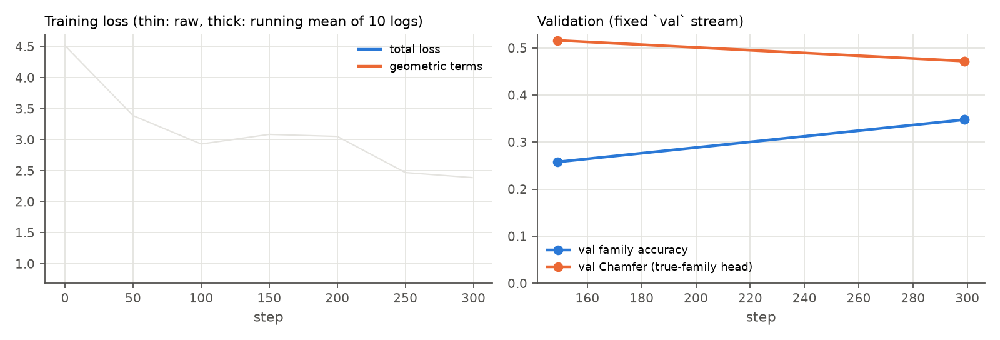
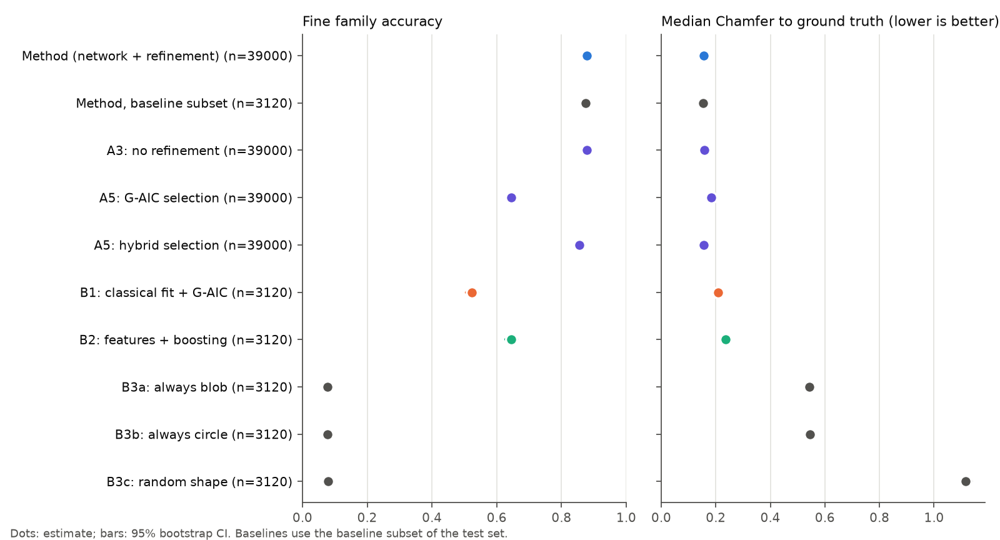
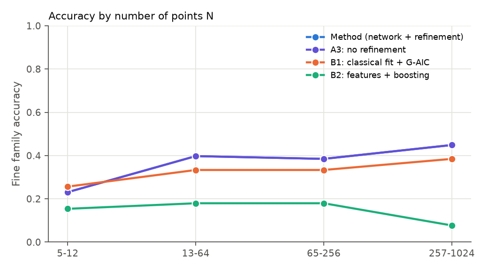
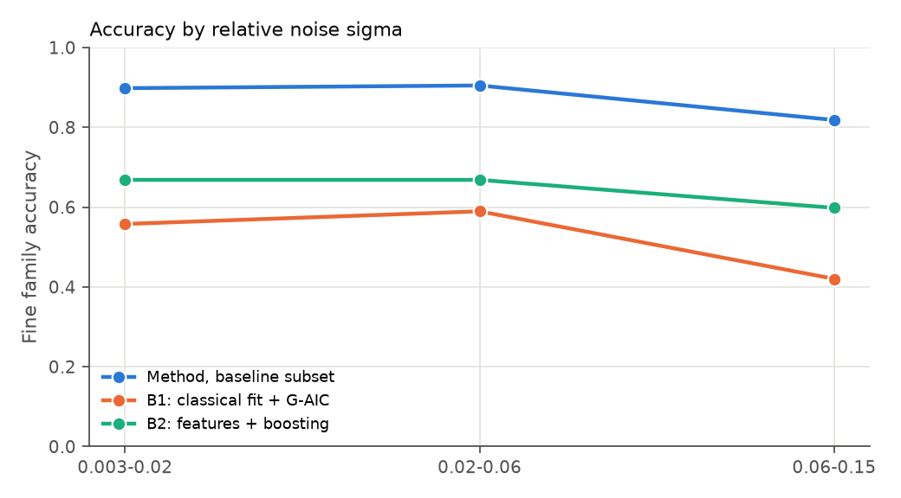
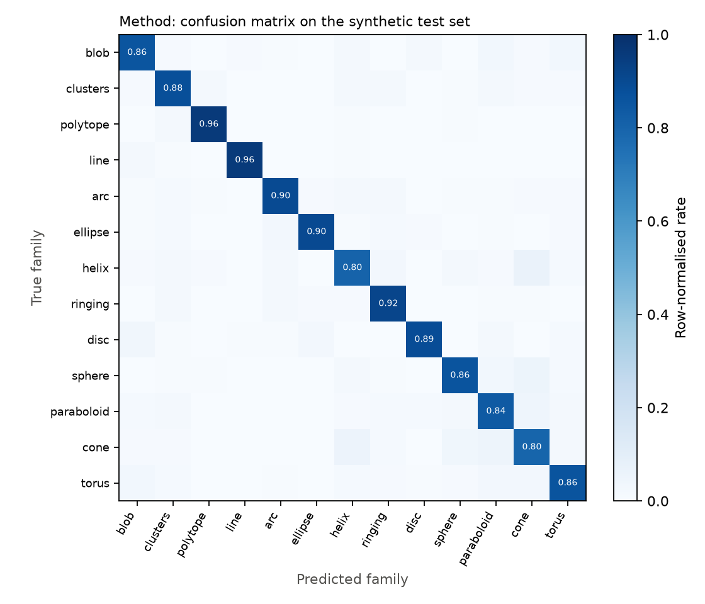
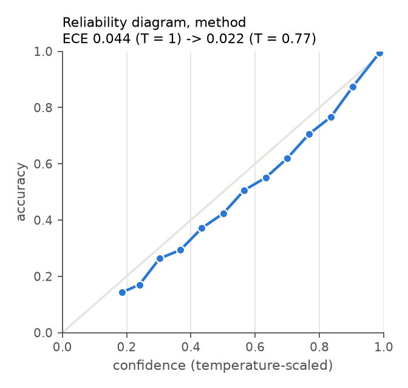
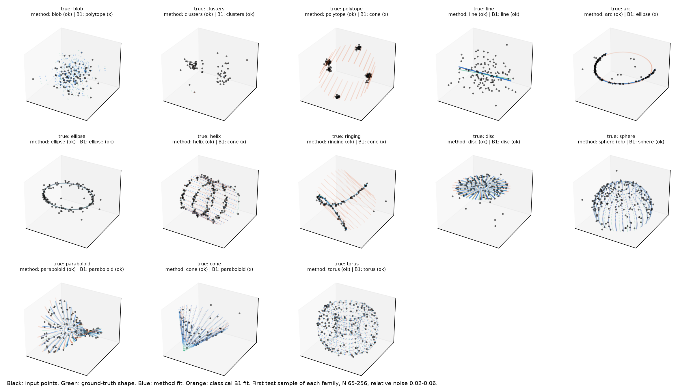

# Experiment 1: training the fitter and evaluating it on synthetic shapes

**Run:** `main_s0`
- Config: `configs/main.yaml` on top of `configs/base.yaml`.
- Commands, in order:
  - `uv run python run.py train --config main.yaml`
  - `uv run python run.py eval-synth --config main.yaml`
  - `uv run python run.py report --config main.yaml`
- Logs: `logs/*_main_s0_*.log`.

Numbers between the markers are generated from `results/main_s0/` and must not be edited by hand.

## Question
The network is trained only on synthetic shapes. Does it identify the shape family and recover the shape better than the strongest classical alternative? That alternative fits every family and picks one with geometric AIC. This is preregistered as H1 and H2. Does test-time refinement help (H5b)?

## Setup
- **Model:** Set Transformer (ISAB×2 with 16 inducing points, PMA, d = 128) with 13 per-family parameter heads. The parameter count is in the models table below.
- **Data:** on-the-fly synthetic shapes from the `train` seed stream, with the nuisances listed in [../docs/methodology.md](../docs/methodology.md).
- **Loss:** CE + Chamfer(predicted shape, noise-free ground-truth shape) + 0.5·residual + annealed auxiliary terms.
- **Optimization:**
  - AdamW, lr 3e-4, warmup then cosine schedule;
  - batch 512, token budget 262144;
  - wall-clock cap of 110 minutes on an RTX 5070 Laptop (8 GB).
- **Test set:** stream `test`, 250 clouds per cell of family × N-bin × noise-bin, 39,000 clouds in total.
- **Baselines:** run on a fixed subset of 20 clouds per family per cell (3,120 clouds); see [deviations.md](deviations.md).

## Models trained

<!-- BEGIN:models_table -->
<!-- END:models_table -->

## Results

<!-- BEGIN:results_table -->
<!-- END:results_table -->

The table above restricted to test clouds that no simpler family fits equally well (the "unambiguous" subset):

<!-- BEGIN:unambiguous_table -->
<!-- END:unambiguous_table -->

### Preregistered hypotheses

<!-- BEGIN:hypotheses_table -->
<!-- END:hypotheses_table -->

### Figures
- Training curves: 
- Systems compared: 
- Accuracy against N and against noise:  
- Confusion matrix: 
- Calibration: 
- Example fits, method versus classical B1: 

## Learnings
These notes record what we tried, what went wrong, and how each problem was found and fixed. The timings were measured with `torch.profiler` and wall-clock timers during development; they are development observations, not results.

1. **Batched small linear algebra on the GPU was the bottleneck, not the model.**
   - The first generator took about 0.3 s per training step. The torch profiler showed `linalg_qr` accounting for 75% of CPU time with 68k kernel launches: batched QR on CUDA launches about one kernel per matrix.
   - Fix: random rotations from normalized 4D Gaussians, i.e. unit quaternions (Shoemake 1992); determinants via the triple product; tiny SVDs and eigendecompositions moved to the CPU.
   - FP64 `eigh` on the GPU was also slow, because consumer GPUs run FP64 at roughly 1/64 of FP32 throughput. It now runs in FP32 on the GPU, with FP64 kept for real data on the CPU.
   - Result: the generator became about 7× faster, at 0.04 s per step.
2. **Training is kernel-launch bound.**
   - The GPU was busy for only about 20% of each step. A batch of 512 costs about the same wall time as a batch of 256, so throughput doubled.
   - A batch of 512 with N = 1024 exceeded 8 GB, and Windows silently spilled into shared memory at 3.3 s per step. A token budget (batch × N ≤ 262144) prevents this.
3. **PCA of a 3D subspace of R^D can return a mirrored frame.**
   - In 3D we force det = +1. With D > 3, however, the map from the shape's 3D frame to the PCA frame can be a reflection.
   - Ground-truth parameters therefore need a mirror-aware transform: a y-mirror for most families, which flips the helix pitch sign, and a z-mirror for the ringing curve, which flips a3. A regression test checks reflections for every family.
4. **Flat shapes plus a 3rd PC that is pure noise make the frame map rank-deficient.**
   - For an arc embedded in R^64 with no noise, the third PC is an arbitrary null direction. The 3×3 map from the shape frame to the PCA frame then has singular values (1, 1, 0).
   - Using the mean singular value as the scale was wrong. The correct scale is exactly 1/RMS, because both maps are isometries on the shape's plane.
   - The Chamfer target never had this problem, because it is computed from exactly projected ground-truth samples.
5. **Test-design pitfalls caught by TDD.**
   - Comparing shapes point by point fails after a mirror, because the traversal direction flips. Shapes must be compared as point sets.
   - Symmetry tests need a sampling much finer than the grid's half-spacing. Otherwise a rotated phase grid looks like an error.

<!-- BEGIN:exp01_learnings_results -->
<!-- END:exp01_learnings_results -->
